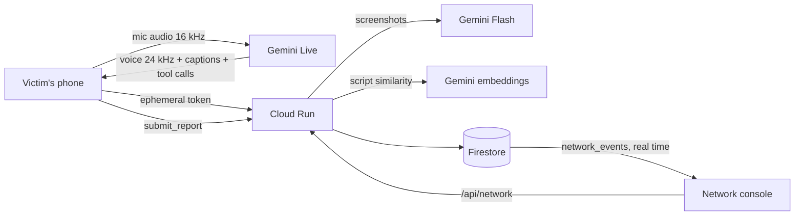

# Golden Hour

**Report a scam by talking, in any language. Every report is linked to other victims across Asia-Pacific, so the accounts can be frozen before the next person pays.**

> The **golden hour** is the short window after a scam payment when the money can still be frozen. Police and banks across Asia-Pacific, from India's 1930 helpline to Singapore's anti-scam centre, say the same thing: report within the first hour. Golden Hour helps people use that hour, and links every report so the next victim never has to.

## The problem

Scam money moves through mule accounts within hours, often across borders. Victims, many of them older, frightened, or not confident with forms, lose that time working out who to call. Each report also sits in one bank or one country, so nobody sees that the same account was paid by five victims in three countries this afternoon.

## What Golden Hour does

**For the victim: a voice-first assistant.** Tap once and talk, in any of 99 languages. Golden Hour (Gemini Live) asks one simple question at a time, tells them to call their national scam hotline right away, fills in the report as they speak, reads it back for confirmation, and submits it. Typing, tapping and screenshots are equal alternatives, never requirements.

**For banks and anti-scam centres: the scam network.** Every report is linked by shared accounts, payment IDs and phone numbers, and by the *script* the scammer used (matched across languages with Gemini embeddings). The map shows rings forming across countries. When an account crosses the freeze threshold (3+ victims in 3 hours), an alert appears with a one-click freeze request.

**Before anyone pays: Check a message.** Paste or say a suspicious text, number, account, payment ID or link. Golden Hour looks it up in the scam network ("this account was paid by 5 victims in 3 countries in the last 3 hours") and Gemini explains the warning signs in the person's own language, with one tap to warn family.

**The golden hour, made visible.** As soon as the person says when they paid, a countdown shows how much of the first hour is left, because that is when banks can most often stop the money.

**Scams going around.** The home screen lists the scams police in the selected country are warning about, each with one simple way to spot it.

**Stay safe (prevention).**
- **Practice call:** a pretend scammer calls (fake police, bank “fraud team”, “Hi Mum”, task jobs). The person practises saying no, gets instant feedback and a score, and can challenge their family. With a Gemini key, Gemini Live plays the scammer and answers whatever they say, in their language, then coaches them.
- **Call shield:** put a suspicious call on speaker; Golden Hour transcribes it live and warns the moment it hears a “safe account”, a request for a code, secrecy or remote-access apps.
- **Family guardian:** one trusted person, stored only on the device. Reporting a scam, a high-risk check or a call-shield warning prepares an alert for them (shown, never sent, in demo mode).

**After reporting (recovery).**
- **Recovery tracker:** reference numbers for the hotline, bank and police, a day 0 to day 30 follow-up timeline with due/overdue status, and calendar reminders (.ics).
- **Case file in one tap:** Gemini turns the report, which may have been spoken in Malay or Thai, into a formal English case file for police and bank fraud teams, ready to print or save as PDF.

**Share to check.** Installed as an app on Android, Golden Hour appears in the share sheet: share a suspicious WhatsApp or SMS message and it opens in the checker.

**Screens in nine languages.** English, हिन्दी, தமிழ், Bahasa Melayu, Bahasa Indonesia, ไทย, 日本語, 中文 and Filipino, auto-detected and switchable. (Translations were written for the prototype and should be reviewed by native speakers.)

**Measured impact.** The network page shows money paid into accounts flagged to freeze, accounts flagged, reports linked across borders, and the median time to report, all computed from the reports themselves.

**One-click demo for judges.** “Play the demo” runs a full sample report by itself, with the countdown, then opens the network where the report links and the freeze alert chimes.

**The demo moment:** open the network in one tab, report a scam by voice in another. The new report lands on the map, its thread draws onto an account that four earlier victims paid in three countries, and "Freeze this account now" appears.

## Built for everyone (WCAG 2.2 AA)

| Who | How |
|---|---|
| Blind and low-vision | Whole flow by voice; screen reader mode so two voices never overlap; audio cue on "your turn"; text to 200%; high contrast; numbers read digit by digit |
| Deaf and hard of hearing | Live captions of both sides (Gemini Live transcription); nothing audio-only; tap or type every answer; visible listening meter; vibration on phones |
| Older users, low literacy, cognitive disabilities | One question at a time; tap answers (Yes, No, I don't know, Repeat, Say it more simply); Easy read mode; no time limits; report read back before sending |
| Limited movement | Full keyboard and switch access; 44 px targets; no dragging |
| Any language | Gemini Live speaks and understands 99 languages and follows the person when they switch |

Lighthouse (production build, measured in development): Accessibility 100, Best practices 100, SEO 100 on every page tested; Performance about 95 on desktop and 70 to 80 on simulated slow mobile.

Automated audit: **0 axe-core violations** (WCAG 2.0/2.1/2.2 A and AA rules plus best practices) on every page. Colour contrast: body text 15:1 or more, secondary text 6:1 or more, in light, dark and high contrast. Details and known limitations: `/accessibility`.

## Google Cloud

| Technology | Role |
|---|---|
| **Gemini Live** (`gemini-3.8-live`) | Real-time voice conversation, browser to Gemini, with input and output transcription (captions) and function calling: `save_report_details`, `submit_report`, `get_official_help`. The server mints a single-use **ephemeral token** locked to the model and system instructions, so the API key never reaches the browser. |
| **Gemini** (`gemini-3.8-flash`) | Reads screenshots (chats, bank alerts) in any language into structured report fields; understands answers in guided mode. |
| **Gemini embeddings** (`gemini-embedding-001`) | Matches scam scripts across languages ("safety account" / "akaun keselamatan" / "保全口座") to link reports to rings. |
| **Cloud Run** | Next.js app and APIs: voice sessions, linking engine, network, reports. |
| **Firestore** | Reports and the network; a tiny public `network_events` stream with no personal data. |
| **Firebase** | Hosting (front door to Cloud Run), Anonymous Auth, and a real-time Firestore listener so every open network console updates the instant a report is linked anywhere. |
| **Cloud Storage** | Screenshot evidence, auto-deleted after 30 days. |



## Try it (judges)

1. Open **Scam network** in one tab and **Report a scam** in another.
2. Tap the microphone and describe a scam in any language. Or open "Judging or testing? Use a sample case" for screenshots from Singapore, Australia, Japan (in Japanese) or India.
3. Confirm the summary. Watch the network tab link the report and raise the freeze alert.
4. Open **Accessibility** in the header to try text size, high contrast, easy read and screen reader mode.

First visit opens a **quick tour**: speech bubbles point at each part of the screen and explain it (the ? button or "How it works" reopens it). The network page has its own tour.

On the network page, **Run live demo** replays a cross-border match without needing a voice report.

Without a Gemini key, the app still works end to end in **guided mode**: the browser's own speech recognition and voice, tap answers and typing, with an offline parser and lexicon matching.

## Install it as an app

Golden Hour is a Progressive Web App. On Android (Chrome) choose **Install app**, on iPhone (Safari) choose **Share → Add to Home Screen**. It opens full screen with its own icon, a bottom tab bar (Report, Network, Call, Tour, Settings) and app shortcuts. A service worker keeps the screens available on a weak connection; reports and API calls are never cached.

## Demo mode (on by default)

So that judges and testers never ring a real hotline or email a real bank, every call, text and email link is intercepted while demo mode is on. Tapping "Call 1799" explains what would happen in the live service instead of dialling, and tells anyone who has really lost money to use their own phone. A notice at the top of every page says it is a demo. Freeze requests on the network page are simulated too.

Demo mode is on unless the server sets `DEMO_MODE=false`. If the settings can't be loaded, the browser assumes demo mode, so the safe behaviour is the default. Only turn it off for a real launch, with the agencies' agreement.

## Countries

Verified official channels for Singapore (1799), Malaysia (997), Thailand (1441), the Philippines (1326), Indonesia (157, IASC), India (1930), Japan (110), Australia (bank, then IDCARE and ReportCyber) and Hong Kong (bank, then 18222). They live in `src/lib/regions.ts`.

## Deploy and test checklist

See [`DEPLOYMENT.md`](DEPLOYMENT.md) for step-by-step deployment (Google Cloud Shell), the phone test checklist, video, submission and troubleshooting.

## Run locally

```bash
npm install
cp .env.example .env.local   # add GEMINI_API_KEY for live voice
npm run dev
```

## Deploy

From Google Cloud Shell, inside the project folder:

```bash
./deploy.sh
```

It deploys to the golden_hour project (`golden-hour-511809`) and asks once for the Gemini API key (`golden-hour-gemini`), which it stores in Secret Manager. To deploy to another project, `export PROJECT_ID=...` first. Then enable **Anonymous** sign-in in Firebase console → Authentication. Check `/api/health`.

## Privacy and safety

- The assistant never asks for PINs, passwords, one-time codes, ID numbers or addresses, and stops people who start to say one. The server also strips card-like numbers.
- Only city-level location is stored.
- Victims' names and contact details for letters stay in their own browser.
- The network view shows accounts and amounts, never victims' identities.
- Everything is filed by the victim through official channels. Golden Hour never contacts banks or police on anyone's behalf.

## Sources for official channels

- Singapore: [ScamShield Helpline](https://www.scamshield.gov.sg/check-for-scams/scamshield-helpline/)
- Malaysia: [NSRC 997](https://www.malaysia.gov.my/en/topics/nsrc-997-hotline)
- Thailand: [AOC 1441](https://www.mdes.go.th/AOC1441/En)
- Philippines: [I-ARC 1326](https://alpha.pna.gov.ph/articles/1207775)
- Australia: [Scamwatch](https://www.scamwatch.gov.au/stop-check-protect/what-to-do-if-youve-been-scammed)
- Hong Kong: [ADCC 18222](https://www.adcc.gov.hk/en-hk/contact-us.html)
- Indonesia: [IASC](https://iasc.ojk.go.id)
- India: [cybercrime.gov.in](https://cybercrime.gov.in)

## Limitations

- The live voice path was built against the Gemini Live API docs and SDK but needs a key to test end to end; it falls back to guided mode automatically if anything fails.
- Seed network data is fictional. The freeze threshold (3 victims in 3 hours) is a demo rule, not a bank policy.
- Screen labels are English; the assistant speaks the user's language.
